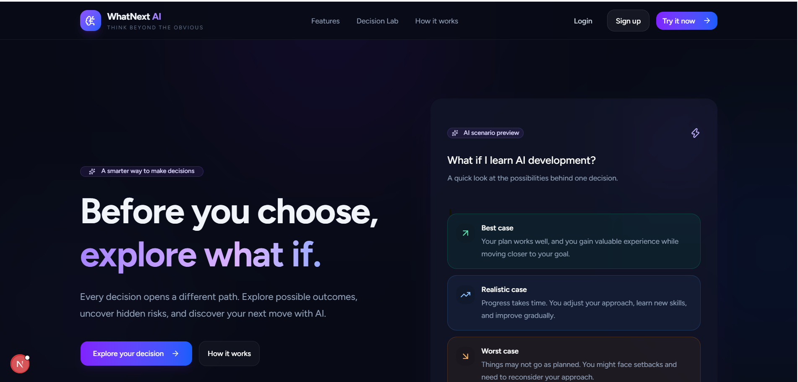

# WhatNext AI 🧠

## 🖥️ Website Preview

### From Uncertainty to a Clearer Decision.

WhatNext AI is an AI-powered decision-making application designed to help people understand difficult choices, explore possible scenarios, evaluate risks, and develop practical plans for moving forward.

The platform helps users think more clearly about their options by organizing decisions into structured analysis, possible outcomes, and actionable next steps.

## ✨ Key Features

- **AI-Powered Decision Analysis** — Explore complex decisions with structured AI-generated insights.
- **Scenario Exploration** — Examine different possibilities and their potential outcomes.
- **Pros and Cons Analysis** — Understand the advantages and disadvantages of different choices.
- **Risk Assessment** — Identify potential risks and uncertainties before making a decision.
- **Personalized Recommendations** — Receive suggestions based on the decision and priorities provided.
- **Action Plans** — Turn decisions into practical next steps.
- **User Authentication** — Secure account registration and sign-in.
- **User Dashboard** — Access personalized application features.
- **Profile Management** — Update personal profile information.
- **Admin Dashboard** — View registered users and monitor account registrations.

## 🛠️ Technologies Used

| Technology | Purpose |
|---|---|
| Next.js | Full-stack application framework |
| React | User interface |
| TypeScript | Type-safe development |
| Tailwind CSS | Responsive styling |
| Prisma ORM | Database access |
| PostgreSQL | Relational database |
| Neon | Cloud database hosting |
| Better Auth | Authentication and session management |
| AI Integration | Decision analysis and intelligent guidance |

## ⚙️ How It Works

### 01 — Describe

Describe the decision you are facing, your goals, and the factors that matter to you.

### 02 — Explore

Explore possible scenarios, compare alternatives, and understand potential benefits, disadvantages, and risks.

### 03 — Analyze

Review the available information and evaluate the possible consequences of different choices.

### 04 — Decide

Use the analysis to identify a suitable next step and prepare a practical action plan.

## 🎯 Project Goals

WhatNext AI aims to make decision-making more structured and accessible by helping users:

- Think critically about important choices.
- Understand possible outcomes before acting.
- Recognize risks and trade-offs.
- Make decisions aligned with their goals and priorities.
- Turn uncertainty into actionable plans.

## 🔐 Security and Administration

The application includes user authentication and an administrative dashboard for viewing registered users.

Administrative features should be protected by appropriate server-side authorization to prevent unauthorized access to sensitive user information.

## 👩‍💻 Developer

**Rahma Nor**

Aspiring AI Full-Stack Engineer passionate about building intelligent applications and solving real-world problems through technology.

GitHub: [Eng-Rahma-Nor-Abdirahman](https://github.com/Eng-Rahma-Nor-Abdirahman)

## 💡 Our Vision

To help people approach difficult decisions with greater clarity, confidence, and a better understanding of their options.

---

**WhatNext AI — Explore your options. Understand the possibilities. Choose your next step.**